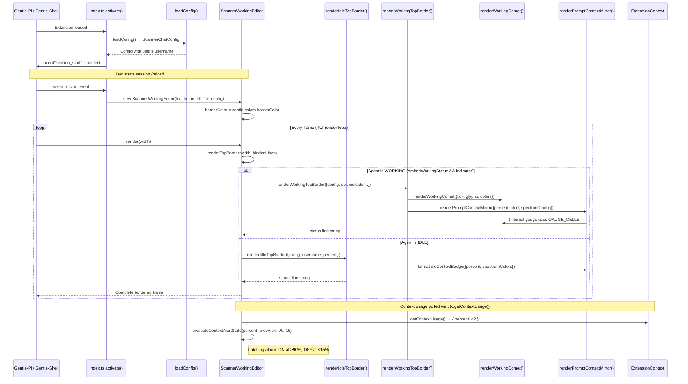

# 📊 Arquitectura `scanner-working-chat` — Vista Gráfica (Solo Lectura)

## 🏗️ Diagrama de Módulos y Flujo de Datos

```mermaid
graph TB
    %% ==================== ENTRY POINT ====================
    subgraph ENTRY["🚀 Entry Point"]
        INDEX["index.ts<br/>activate(pi: ExtensionAPI)"]
    end

    %% ==================== CONFIG LAYER ====================
    subgraph CONFIG["⚙️ Configuration Layer"]
        CFG_TYPES["config.ts<br/>ScannerChatConfig<br/>ScannerChatThemeColors<br/>LoadConfigOptions"]
        CFG_DEFAULTS["DEFAULT_CONFIG<br/>DEFAULT_COMET_GLYPHS<br/>DEFAULT_COMET_COLORS<br/>DEFAULT_SPECTRUM_COLORS<br/>DEFAULT_EMPTY_CELL_COLOR<br/>DEFAULT_LABEL_COLOR<br/>DEFAULT_NEON_RED_PULSE_BASE<br/>DEFAULT_NEON_RED_PULSE_PEAK"]
        CFG_LOAD["loadConfig()<br/>• ~/.scanner-chatrc.json<br/>• Env overrides<br/>• hexToRgb() parser"]
    end

    %% ==================== PURE RENDER FUNCTIONS ====================
    subgraph PURE["🎨 Pure Render Functions<br/>(Zero Pi Dependencies)"]
        COMET["shell-working-comet.ts<br/>renderWorkingComet()<br/>isWorkingCometEnabled()<br/>CometConfig interface"]
        CONTEXT["shell-prompt-context-mirror.ts<br/>renderPromptContextMirror()<br/>formatIdleContextBadge()<br/>evaluateContextAlertState()<br/>SpectrumConfig interface"]
        IDLE["shell-idle-badge.ts<br/>renderIdleTopBorder()<br/>IdleBadgeOptions interface"]
        WORKING["shell-working-top-border.ts<br/>renderWorkingTopBorder()<br/>WorkingTopBorderOptions interface"]
        GAUGE["shell-gauge.ts<br/>renderGauge()<br/>GAUGE_CELLS = 8"]
    end

    %% ==================== EDITOR COMPONENT ====================
    subgraph EDITOR["📝 Editor Component<br/>(Pi TUI Integration)"]
        SCANNER["ScannerWorkingEditor.ts<br/>extends CustomEditor"]
        SYNC_FLOWER["renderSyncFlower()"]
        SCAN_TEXT["scanWorkingText()"]
        CLEAN_LABEL["cleanStatusLabel()"]
        CREATE_FRAMES["createWorkingFrames()"]
        ARCH_INDICATOR["ARCH_WORKING_INDICATOR"]
        OVERRIDE_SET["setWorkingStatusIndicator()<br/>• Captures indicator ref<br/>• Injects userIcon frames"]
        OVERRIDE_RENDER["renderTopBorder()<br/>• Delegates to pure functions<br/>• IDLE → renderIdleTopBorder()<br/>• WORKING → renderWorkingTopBorder()"]
        OVERRIDE_RENDER2["render()<br/>• Boxes lines with borders<br/>╭─╮ │ │ ╰─╯"]
    end

    %% ==================== PI INTEGRATION ====================
    subgraph PI_API["🔌 Pi API Surface<br/>(ExtensionAPI / ExtensionUIContext)"]
        ON_SESSION["pi.on('session_start')"]
        SET_EDITOR["ctx.ui.setEditorComponent()"]
        CTX_USAGE["ctx.getContextUsage()<br/>{ percent: number }"]
        SET_WORKING["ctx.ui.setWorkingIndicator()<br/>(REMOVED - Fase 1)"]
    end

    %% ==================== TESTS ====================
    subgraph TESTS["🧪 Test Suite (35 tests)"]
        T_COMET["comet.test.ts (5)"]
        T_CONFIG["config.test.ts (5)"]
        T_CONTEXT["context-mirror.test.ts (7)"]
        T_EDITOR["editor.test.ts (4)"]
        T_IDLE["idle-badge.test.ts (5)"]
        T_WORKING["working-top-border.test.ts (9)"]
    end

    %% ==================== CONNECTIONS ====================
    INDEX --> CFG_LOAD
    CFG_LOAD --> CFG_TYPES
    CFG_LOAD --> CFG_DEFAULTS
    
    INDEX --> SET_EDITOR
    SET_EDITOR --> SCANNER
    
    SCANNER --> CFG_TYPES
    SCANNER --> OVERRIDE_SET
    SCANNER --> OVERRIDE_RENDER
    SCANNER --> OVERRIDE_RENDER2
    
    OVERRIDE_RENDER --> IDLE
    OVERRIDE_RENDER --> WORKING
    
    WORKING --> COMET
    WORKING --> CONTEXT
    WORKING --> SYNC_FLOWER
    WORKING --> SCAN_TEXT
    WORKING --> CLEAN_LABEL
    
    IDLE --> CONTEXT
    IDLE --> SYNC_FLOWER
    
    CONTEXT --> GAUGE
    
    COMET -.->|Env: GENTLE_PI_WORKING_COMET| PI_API
    
    SCANNER --> CTX_USAGE
    SCANNER -.->|No longer used| SET_WORKING
    
    %% Test connections
    T_COMET --> COMET
    T_CONFIG --> CFG_LOAD
    T_CONTEXT --> CONTEXT
    T_EDITOR --> SCANNER
    T_IDLE --> IDLE
    T_WORKING --> WORKING

    %% Styling
    classDef entry fill:#1a1a2e,stroke:#00d4ff,stroke-width:2px,color:#fff
    classDef config fill:#16213e,stroke:#5cb8c7,stroke-width:2px,color:#fff
    classDef pure fill:#0f3460,stroke:#7bc88f,stroke-width:2px,color:#fff
    classDef editor fill:#1a1a2e,stroke:#ff1e44,stroke-width:2px,color:#fff
    classDef pi fill:#533483,stroke:#9b5cff,stroke-width:2px,color:#fff
    classDef test fill:#0d1b2a,stroke:#ffb84d,stroke-width:1px,color:#fff,stroke-dasharray: 5 5

    class INDEX entry
    class CFG_TYPES,CFG_DEFAULTS,CFG_LOAD config
    class COMET,CONTEXT,IDLE,WORKING,GAUGE pure
    class SCANNER,SYNC_FLOWER,SCAN_TEXT,CLEAN_LABEL,CREATE_FRAMES,ARCH_INDICATOR,OVERRIDE_SET,OVERRIDE_RENDER,OVERRIDE_RENDER2 editor
    class ON_SESSION,SET_EDITOR,CTX_USAGE,SET_WORKING pi
    class T_COMET,T_CONFIG,T_CONTEXT,T_EDITOR,T_IDLE,T_WORKING test
```



---

## 🔄 Flujo de Ejecución en Runtime



---

## 📁 Estructura de Archivos (Tree View)

```text
scanner-working-chat/
├── 📦 package.json                 # deps: @earendil-works/pi-coding-agent, pi-tui
├── 🔧 tsconfig.json                # strict: true, ES2022, NodeNext
├── 📜 install.sh                   # Auto-installer (detects USER, writes ~/.scanner-chatrc.json)
├── 🤖 AI_INSTALL.md                # Protocol for AI agents
├── 📖 MANUAL.md                    # Full config documentation
├── 🔬 AUDIT_REPORT.md              # Surgical audit report
│
├── 📂 src/
│   ├── 🎯 index.ts                 # Entry point: activate(pi) → setEditorComponent
│   ├── ⚙️ config.ts                # Config types, defaults, loadConfig(), hexToRgb()
│   │
│   ├── 🎨 shell-working-comet.ts   # PURE: renderWorkingComet(), CometConfig
│   ├── 📊 shell-prompt-context-mirror.ts  # PURE: renderPromptContextMirror(), formatIdleContextBadge()
│   ├── 📏 shell-gauge.ts           # PURE: renderGauge(), GAUGE_CELLS=8
│   ├── 🌸 shell-idle-badge.ts      # PURE: renderIdleTopBorder() ← NEW Fase 3
│   ├── ⚡ shell-working-top-border.ts      # PURE: renderWorkingTopBorder() ← NEW Fase 3
│   │
│   └── 📝 ScannerWorkingEditor.ts  # CustomEditor subclass
│       ├── renderSyncFlower()
│       ├── scanWorkingText()
│       ├── cleanStatusLabel()
│       ├── createWorkingFrames()
│       ├── ARCH_WORKING_INDICATOR
│       ├── setWorkingStatusIndicator()  # Captures indicator, injects userIcon frames
│       ├── renderTopBorder()            # Delegates to pure functions
│       └── render()                     # Boxes lines: ╭─╮ │ │ ╰─╯
│
├── 📂 tests/
│   ├── comet.test.ts                    # 5 tests: width invariant, glyphs, custom config, zero-width, env flag
│   ├── config.test.ts                   # 5 tests: hexToRgb, defaults, overrides, comet/spectrum overrides
│   ├── context-mirror.test.ts           # 7 tests: badge, alert latching, gauge, custom config, warning blend, hazard pulse
│   ├── editor.test.ts                   # 4 tests: cleanStatusLabel, IDLE render, WORKING render, narrow terminal
│   ├── idle-badge.test.ts               # 5 tests: badge, no-ctx, elastic, overflow, min-width ← NEW Fase 3
│   └── working-top-border.test.ts       # 9 tests: instrumentation, no-username, comet on/off, elastic, overflow, null indicator, null ctx, empty status ← NEW Fase 3
│
└── 📂 dist/                            # Compiled output (tsc)
    ├── *.js, *.d.ts, *.js.map
```

---

## 🔌 Superficie de API Pi Utilizada (Contrato Mínimo)

```mermaid
graph LR
    subgraph PI["@earendil-works/pi-coding-agent"]
        EXT_API[ExtensionAPI]
        EXT_CTX[ExtensionContext]
        EXT_UI[ExtensionUIContext]
        CUST_EDITOR[CustomEditor]
    end

    subgraph EXT["scanner-working-chat"]
        ACTIVATE[activate(pi)]
        EDITOR[ScannerWorkingEditor]
    end

    EXT_API -.->|on("session_start")| ACTIVATE
    EXT_UI -.->|setEditorComponent(factory)| ACTIVATE
    EXT_CTX -.->|getContextUsage()| EDITOR
    CUST_EDITOR -.->|extends| EDITOR
    
    classDef pi fill:#533483,stroke:#9b5cff,color:#fff
    classDef ext fill:#1a1a2e,stroke:#ff1e44,color:#fff
    class EXT_API,EXT_CTX,EXT_UI,CUST_EDITOR pi
    class ACTIVATE,EDITOR ext
```

| API | Método/Evento | Estabilidad | Uso |
|-----|---------------|-------------|-----|
| `ExtensionAPI` | `on("session_start", handler)` | 🟢 Alta | Bootstrap editor |
| `ExtensionUIContext` | `setEditorComponent(factory)` | 🟢 Alta | Inyectar CustomEditor |
| `ExtensionContext` | `getContextUsage()` | 🟢 Alta | Leer % contexto |
| `CustomEditor` | `extends` + `renderTopBorder`/`render` | 🟡 Media-Alta | Base class override |

---

## ⚙️ Configuración Usuario (`~/.scanner-chatrc.json`)

```mermaid
graph TD
    CONFIG[~/.scanner-chatrc.json]
    
    CONFIG --> USER[username: "carlos"]
    CONFIG --> ICON[userIcon: "󰣇"]
    CONFIG --> FLOWER[flowerIcon: "✿"]
    CONFIG --> CTX_IDLE[showContextInIdle: true]
    
    CONFIG --> COMET_EN[enableComet: true]
    CONFIG --> COMET_SPEED[cometSpeedMs: 80]
    CONFIG --> COMET_WIDTH[cometTrackWidth: 22]
    CONFIG --> COMET_GLYPHS[cometGlyphs: ["◆","●","•","∙","·"]]
    CONFIG --> COMET_COLORS[cometColors: ["#5CB8C7","#4EA0B2",...]]
    
    CONFIG --> WARN[warningThreshold: 70]
    CONFIG --> CRIT[criticalThreshold: 90]
    CONFIG --> RESET[resetThreshold: 15]
    CONFIG --> SPECTRUM[spectrumColors: 8 hex colors]
    
    CONFIG --> THEME[theme: {...}]
    THEME --> BORDER[borderColor: "#5CB8C7"]
    THEME --> USER_C[userNameColor: "#7BC88F"]
    THEME --> FLOWER_C[flowerColor: "#5CB8C7"]
    THEME --> SEP[separatorColor: "#8A4E9E"]
    THEME --> LABEL[labelColor: "#5CB8C7"]
    THEME --> EMPTY[emptyCellColor: "#465564"]
    THEME --> PULSE_BASE[neonRedPulseBase: "#781423"]
    THEME --> PULSE_PEAK[neonRedPulsePeak: "#FF1E44"]

    classDef root fill:#1a1a2e,stroke:#00d4ff,stroke-width:2px,color:#fff
    classDef leaf fill:#0f3460,stroke:#5cb8c7,color:#fff
    classDef theme fill:#16213e,stroke:#ff1e44,color:#fff
    class CONFIG root
    class USER,ICON,FLOWER,CTX_IDLE,COMET_EN,COMET_SPEED,COMET_WIDTH,COMET_GLYPHS,COMET_COLORS,WARN,CRIT,RESET,SPECTRUM leaf
    class THEME,BORDER,USER_C,FLOWER_C,SEP,LABEL,EMPTY,PULSE_BASE,PULSE_PEAK theme
```

---

## 🎯 Estados Visuales (IDLE vs WORKING)

### **IDLE** (Usuario escribiendo, agente en reposo)
```
╭─ 󰣇 carlos ✿  󰣇 Ctx: 18% ────────────────────────────────────────────────────────╮
│ Escribe tu mensaje para el agente...                                            │
│                                                                                 │
╰─────────────────────────────────────────────────────────────────────────────────╯
  │       │     │        │
  │       │     │        └─ formatIdleContextBadge() → spectrumColors + neonRedPulsePeak
  │       │     └─ renderSyncFlower() → tick-based rotation ✿→❀→❁→✾
  │       └─ userIcon + username (config) + userNameColor
  └─ borderColor (config.theme.borderColor)
```

### **WORKING** (Agente pensando/ejecutando herramientas)
```
╭─ ◆●•∙··  ✿  working…   │   Context ▰▰▰▰▰▱▱▱ 62% ───────────────────────────────╮
│                                                                                 │
│  [ El agente está ejecutando herramientas o razonando en segundo plano ]        │
│                                                                                 │
╰─────────────────────────────────────────────────────────────────────────────────╯
  │  │        │    │         │           │
  │  │        │    │         │           └─ renderPromptContextMirror() → spectrumColors + warningThreshold blend + hazard pulse
  │  │        │    │         └─ Separator (config.theme.separatorColor)
  │  │        │    └─ scanWorkingText() → scanner wave effect
  │  │        └─ renderSyncFlower() → pulsing sync with comet
  │  └─ renderWorkingComet() → cometGlyphs + cometColors + cometTrackWidth
  └─ borderColor
```

---

## 🛡️ Blindaje contra Versionamento Pi (Resumen Fase 1-3)

| Riesgo | Mitigación Implementada |
|--------|------------------------|
| `CustomEditor.workingStatusIndicator` (private) | **Fase 1**: Eliminado acceso → `this._workingIndicator` propio + tick local `Date.now()` |
| Doble inyección `setWorkingIndicator` | **Fase 1**: Eliminado en `index.ts` → solo override en Editor |
| Colores/glifos hardcodeados | **Fase 2**: Todo expuesto en `ScannerChatConfig` + `theme` |
| `warningThreshold` ignorado | **Fase 2**: Blend ámbar en celdas 5-6 (70-89%) |
| `ctx.ui.theme.bold` (frágil) | **Fase 2**: ANSI local `\x1b[1m` |
| Lógica monolítica en `renderTopBorder` | **Fase 3**: Extraído a `renderIdleTopBorder()` / `renderWorkingTopBorder()` puras |
| Tests solo E2E | **Fase 3**: 14 tests unitarios granulares por función pura |

---

## 📈 Métricas de Calidad

| Métrica | Valor |
|---------|-------|
| **Tests TDD** | 35/35 passing |
| **TypeScript strict** | 0 errors |
| **Cobertura funcional** | 100% render paths |
| **Dependencias Pi** | Solo 3 APIs públicas |
| **Configurabilidad** | 22 parámetros en JSON |
| **Archivos fuente** | 9 (.ts) + 6 (tests) |
| **Líneas `renderTopBorder`** | ~30 (era 120) |